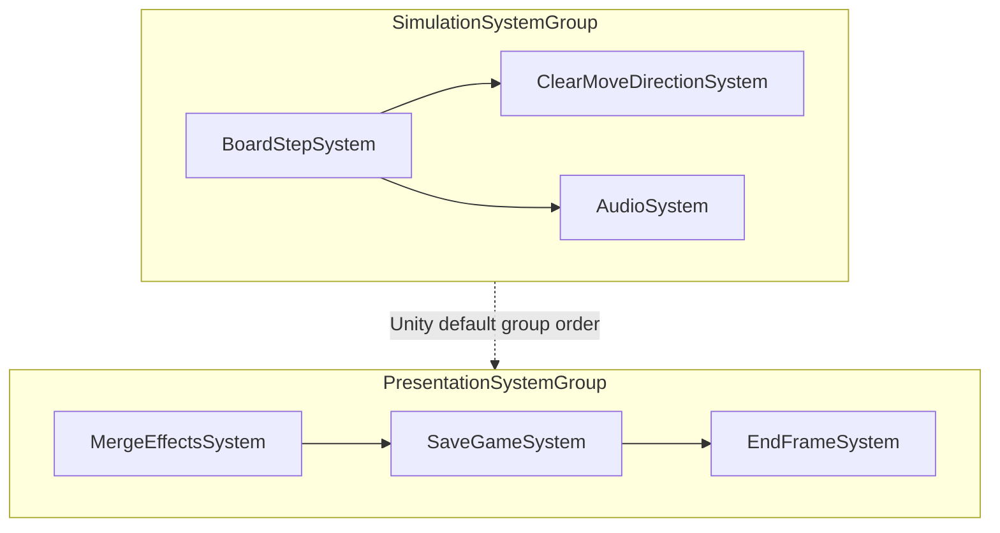

# ECS frame order

## Purpose
Describes every ECS system in the game, the order they run in within a frame, the singletons and event entities they share, where structural changes happen, and what one player move looks like from input to end of frame. *What* a move does (sliding, merging, scoring, spawning, game over) is decided by the pure simulation described in [merge-rules.md](merge-rules.md); how the singletons and configuration get created is in [configuration.md](configuration.md).

Since CC-006.3 ([ADR-001](../decisions/ADR-001-pure-board-simulation.md)) one system, `BoardStepSystem`, wraps the simulation and replaces the five move systems (`InputProcessingSystem`, `BlockMovementSystem`, `ResolveNewBlocksSystem`, `SpawnColorSystem`, `GameEndConditionSystem`). `ScoringSystem` became `MergeEffectsSystem`.

All paths below are relative to the Unity project folder (`Cathartic Colours/`).

## Key files
| File | Role |
|---|---|
| `Assets/Scripts/ECS/Systems/BoardStepSystem.cs` | Runs a move through `BoardSimulation.Step` and writes the result back |
| `Assets/Scripts/ECS/Systems/ClearMoveDirectionSystem.cs` | Removes the move command |
| `Assets/Scripts/ECS/Systems/AudioSystem.cs` | Plays and destroys audio event entities |
| `Assets/Scripts/Gameplay/MergeEffectsSystem.cs` | Turns merge events into particles and destroys them (Presentation assembly since CC-002; namespace still `ECS.Systems`) |
| `Assets/Scripts/ECS/Systems/SaveGameSystem.cs` | Saves after a move; deletes the save once on game over |
| `Assets/Scripts/ECS/Systems/EndFrameSystem.cs` | Sets `WaitingForInput` back to true |
| `Assets/Scripts/ECS/Components/*.cs` | Component definitions (see tables below) |
| `Assets/Scripts/Simulation/OccupantTracking.cs` | Keeps each block's entity through a step (pure, unit-tested) |
| `Assets/Scripts/Gameplay/GameRenderer.cs` | Creates and destroys the singletons (`InitializeGame`, `CleanUp`); triggers the jelly wobble |
| `Assets/Scripts/Gameplay/GameInputHandler.cs` | Creates the move command entity |

## How it works

### Systems at a glance
All six systems are `partial struct ... : ISystem`, auto-created in the default world.

| System | Group | Ordering attributes | `RequireForUpdate` | Burst |
|---|---|---|---|---|
| `BoardStepSystem` | Simulation | none (first of the project's Simulation systems through the others' attributes) | `GameStateComponent`, `GridConfigComponent`, `GameRulesComponent`, `ScoreComponent` | yes |
| `ClearMoveDirectionSystem` | Simulation | `[UpdateAfter(BoardStepSystem)]` | none | yes |
| `AudioSystem` | Simulation | `[UpdateAfter(BoardStepSystem)]` | none | no: FMOD `RuntimeManager` |
| `MergeEffectsSystem` | Presentation | `[UpdateBefore(SaveGameSystem)]` | `MergeEventComponent` | no: calls the `PointsParticleSpawner` MonoBehaviour |
| `SaveGameSystem` | Presentation | none (ordered by `MergeEffectsSystem`'s attribute) | `GameStateComponent` | no: file I/O and `JsonUtility` |
| `EndFrameSystem` | Presentation | `[UpdateAfter(SaveGameSystem)]` | `GameStateComponent` | yes |

Sources: the attribute lines and `OnCreate` of each file in `Assets/Scripts/ECS/Systems/` and `Assets/Scripts/Gameplay/MergeEffectsSystem.cs`. Since CC-002 the order between these two is declared on `MergeEffectsSystem`, because the Core assembly (which holds `SaveGameSystem`) can't reference the Presentation assembly; the resolved order is unchanged. Burst for `BoardStepSystem` was checked in a temporary ECS world with synchronous Burst compilation (no Burst errors; CC-006.3 feature page).

### Resolved order
**SimulationSystemGroup:** `BoardStepSystem` → `ClearMoveDirectionSystem` and `AudioSystem` (in either order; they share no data). Audio events created by the step therefore play in the same frame.

**PresentationSystemGroup:** `MergeEffectsSystem` → `SaveGameSystem` → `EndFrameSystem`. Simulation runs before Presentation by Unity's default group order.

Because `EndFrameSystem` is last, the `WaitingForInput = false` set by `BoardStepSystem` on an accepted move is visible to every other system in that frame, and is reset only at the very end.

### Event entities

| Entity component | Created by | Consumed and destroyed by |
|---|---|---|
| `MoveDirectionComponent` (`Direction`) | `GameInputHandler.SendMoveCommand` (only if no such entity exists) | read by `BoardStepSystem`; destroyed by `ClearMoveDirectionSystem` every frame it exists, whether or not the move was accepted |
| `AudioEventComponent` (`EventPath`) | `BoardStepSystem`, only for an accepted move: one `Block_Move`, one merge sound per merge (`Block_Merge_Large` when both blocks are destroyed, otherwise by size: Small if mover or result is Small, else Medium if either is Medium, else Large), and `GameOver` when the move ends the game | `AudioSystem`: `RuntimeManager.PlayOneShot`, then `ecb.DestroyEntity` |
| `MergeEventComponent` (`Position`, `Tier`, `Color`, `Points`) | `BoardStepSystem`, one per merge in an accepted move (including merges that destroy both blocks) | `MergeEffectsSystem`: emits particles if the spawner and renderer exist, and always destroys the event. Score is already applied, so a missing spawner only loses the effect |

### Structural changes

| System | How it changes structure |
|---|---|
| `BoardStepSystem` | One `EntityCommandBuffer` (Temp), played back at the end of an accepted move: `DestroyEntity` for merged-away blocks, `SetComponent(BlockComponent)` for every surviving block, `CreateEntity` + `AddComponent` for the new indicator and the event entities. Game state and score are written through `GetSingletonRW` |
| `ClearMoveDirectionSystem` | Direct `EntityManager.DestroyEntity` |
| `AudioSystem` | ECB: `DestroyEntity` |
| `MergeEffectsSystem` | ECB: `DestroyEntity` |
| `SaveGameSystem` | None (file I/O only) |
| `EndFrameSystem` | None (writes `GameStateComponent`) |

**Entity identity.** `GameRenderer` keeps one GameObject per block entity, so `BoardStepSystem` keeps entities stable: it records which entity is in each cell, replays the step's events over that map with `OccupantTracking.Apply`, and then writes each surviving entity's new data. A block that slides, is merged into, or is a resolved indicator keeps its entity (and its visual); a block merged away is destroyed (its visual plays `Disappear`); a new indicator gets a new entity. This matches what the five old systems did.

### Singletons

| Component | Created by | Written by | Read by |
|---|---|---|---|
| `GridConfigComponent` (`Width`, `Height`) | `GameRenderer.InitializeGame` | not changed after creation | `BoardStepSystem` |
| `GameStateComponent` (`WaitingForInput`, `GameOver`, `LevelComplete`, `MoveCount`, `Random`, `LastMoveDirection`) | `GameRenderer.InitializeGame` (`WaitingForInput = true`, `Random` seeded from `DateTime.Now.Ticks`); fields overwritten on resume by `SaveGameManager.RestoreWorldState` (`LastMoveDirection` is not saved) | `BoardStepSystem` (all but `LevelComplete`); `EndFrameSystem` (`WaitingForInput`) | `BoardStepSystem`, `SaveGameSystem`, `GameRenderer.UpdateUI` (UI and wobble) |
| `ScoreComponent` (`TotalScore`, `CurrentFrameScore`) | `GameRenderer.InitializeGame` (zeros); overwritten on resume | `BoardStepSystem`: adds the step's score delta; `CurrentFrameScore` is this frame's points and is reset to 0 on every other frame | `SaveGameSystem`, `GameUIManager` |
| `GameModeComponent` (`Mode`) | `GameRenderer.InitializeGame` from `config.gameMode` | not changed | UI and saves (`BoardStepSystem` no longer reads it since CC-008.3) |
| `GameRulesComponent` (`Rules`: a `GameRules` naming one rule per family, plus tier points; CC-008.3, replacing `ScoringConfigComponent`) | `GameRenderer.InitializeGame` through `GameRulesComponent.From(config)` (mode, `spawnNextColourSystem`, `tier1Points`..`tier4Points`); a resume goes through the same call after the configuration is rebuilt from the save. Never saved | not changed | `BoardStepSystem` |

`GameRenderer.CleanUp` destroys the block entities, `GridConfigComponent`, `GameModeComponent`, `GameRulesComponent` and the game-state and score entities. It does not destroy pending event entities or a pending `MoveDirectionComponent`.

### One player move, frame by frame
A move takes one ECS frame, starting from `WaitingForInput == true`, `GameOver == false`.

1. **Outside ECS.** A keyboard action (`GameInputHandler.OnMove`) or a swipe (`GameInputHandler.OnSwipe`) calls `SendMoveCommand`, which creates a `MoveDirectionComponent` entity unless one already exists.
2. **`BoardStepSystem`.** Resets `CurrentFrameScore` to 0. With no move command it stops. If `WaitingForInput` is false or `GameOver` is true, the move is **rejected**: nothing changes and no events are created. Otherwise it copies the block entities into a `BoardState`, calls `BoardSimulation.Step` with the `GameRules` singleton (slide, merge, score, resolve the indicator, spawn the next, end check; see [merge-rules.md](merge-rules.md)) and, if the step was accepted:
   - stores the new random state, increments `MoveCount`, sets `LastMoveDirection` and sets `WaitingForInput = false` (the "a move happened" signal for `SaveGameSystem`);
   - if the board is now game over, sets `GameOver = true` and `WaitingForInput = true`;
   - adds the score delta to `ScoreComponent`;
   - writes the board back to the entities (see Entity identity) and creates the audio and merge event entities.
3. **`ClearMoveDirectionSystem`** destroys the move command. **`AudioSystem`** plays this frame's audio events.
4. **Presentation: `MergeEffectsSystem`** emits particles for each merge event and destroys the events.
5. **`SaveGameSystem`** saves the game if `WaitingForInput` is false and the game is not over. When `GameOver` (or `LevelComplete`) first becomes true it deletes the save file, once.
6. **`EndFrameSystem`** sets `WaitingForInput = true`.

`GameRenderer.Update` (a MonoBehaviour) reads the entity data for display. When it sees `MoveCount` increase it starts the jelly wobble in `LastMoveDirection` (`GameRenderer.WobbleOnNewMove`), so no simulation code calls presentation. Because MonoBehaviour `Update` and the ECS groups run at different points in the player loop, the wobble can start one frame after the move.

New game: `GameRenderer.InitializeGame` creates the singletons and one white indicator block at `(gridWidth / 2, gridHeight / 2)`. The first move moves nothing (indicators never move), turns that indicator into a coloured block and spawns the next indicator.

## Interactions with other systems
- Merge, scoring, spawn and end rules: [merge-rules.md](merge-rules.md).
- Singleton creation, configuration and `GameManager`: [configuration.md](configuration.md).
- Presentation reacts to state and events only: [presentation.md](presentation.md). See also [input.md](input.md), [save-system.md](save-system.md), [audio-fmod.md](audio-fmod.md) and [ui-layout.md](ui-layout.md).

## Known issues
- The indicator's colour is only chosen on the following move. [CC-007](https://github.com/rtumelty/Cathartic-Colours/issues/19)
- `GameStateComponent.LevelComplete` is never set by any system. [CC-019](https://github.com/rtumelty/Cathartic-Colours/issues/31)

## Related test cases
- [Standard](../test-plan.md#standard-mode-std): TP-STD-01 to TP-STD-03 (first move, one cell per move, walls).
- [HUD](../test-plan.md#gameplay-hud-hud): TP-HUD-04 (move counter). [Game over](../test-plan.md#game-over-over): TP-OVER-01 to TP-OVER-03 (end condition, moves ignored).
