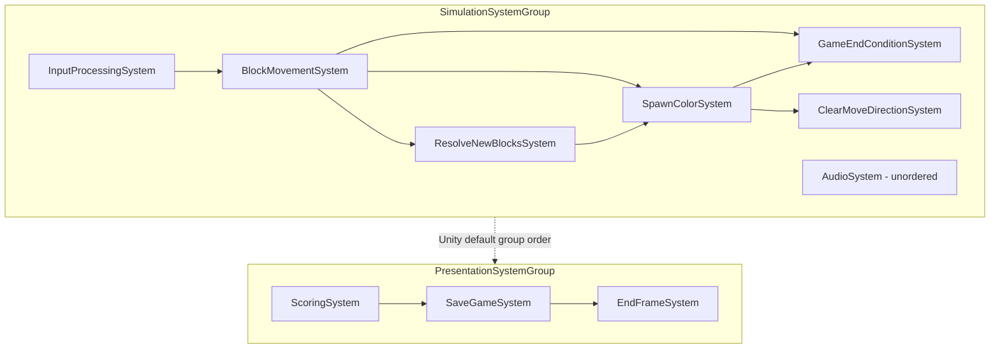

# ECS frame order

## Purpose
Describes every ECS system in the game, the order they run in within a frame, the components that switch systems on and off, the event entities passed between them, where structural changes happen, and what one player move looks like from input to end of frame. Rules that decide *what* a move does (merging, scoring, spawning) are in [merge-rules.md](merge-rules.md); how the singletons and configuration get created is in [configuration.md](configuration.md).

All paths below are relative to the Unity project folder (`Cathartic Colours/`).

## Key files
| File | Role |
|---|---|
| `Assets/Scripts/ECS/Systems/InputProcessingSystem.cs` | Accepts a pending move, arms blocks |
| `Assets/Scripts/ECS/Systems/BlockMovementSystem.cs` | Slides and merges blocks |
| `Assets/Scripts/ECS/Systems/ResolveNewBlocksSystem.cs` | Turns the white indicator block into a coloured block |
| `Assets/Scripts/ECS/Systems/SpawnColorSystem.cs` | Spawns the next white indicator block |
| `Assets/Scripts/ECS/Systems/GameEndConditionSystem.cs` | Detects game over |
| `Assets/Scripts/ECS/Systems/ClearMoveDirectionSystem.cs` | Removes the move command |
| `Assets/Scripts/ECS/Systems/AudioSystem.cs` | Plays and destroys audio event entities |
| `Assets/Scripts/ECS/Systems/ScoringSystem.cs` | Consumes merge events, updates score |
| `Assets/Scripts/ECS/Systems/SaveGameSystem.cs` | Saves or deletes the save file |
| `Assets/Scripts/ECS/Systems/EndFrameSystem.cs` | Sets `WaitingForInput` back to true |
| `Assets/Scripts/ECS/Components/*.cs` | Component definitions (see tables below) |
| `Assets/Scripts/Gameplay/GameRenderer.cs` | Creates and destroys the singletons (`InitializeGame`, `CleanUp`) |
| `Assets/Scripts/Gameplay/GameInputHandler.cs` | Creates the move command entity |

## How it works

### Systems at a glance
All ten systems are `partial struct ... : ISystem`; there is no `SystemBase` anywhere in `Assets/Scripts`. None uses `[DisableAutoCreation]`, so all are auto-created in the default world. `[BurstCompile]` appears only on the three methods of `EndFrameSystem`; every other system runs managed (they use `GameManager`, FMOD, `Debug`, `System.IO` or managed arrays).

| System | Group | Ordering attributes | `RequireForUpdate` | Burst |
|---|---|---|---|---|
| `InputProcessingSystem` | Simulation | `[UpdateBefore(BlockMovementSystem)]` | `GameStateComponent` | no |
| `BlockMovementSystem` | Simulation | none | `GameStateComponent`, `GameModeComponent` | no |
| `ResolveNewBlocksSystem` | Simulation | `[UpdateAfter(BlockMovementSystem)]`, `[UpdateBefore(SpawnColorSystem)]` | `GameStateComponent` | no |
| `SpawnColorSystem` | Simulation | `[UpdateAfter(BlockMovementSystem)]` | `GameStateComponent`, `SpawnColorSystemTag` | no |
| `GameEndConditionSystem` | Simulation | `[UpdateAfter(BlockMovementSystem)]`, `[UpdateAfter(SpawnColorSystem)]` | `GameModeComponent` | no |
| `ClearMoveDirectionSystem` | Simulation | `[UpdateAfter(SpawnColorSystem)]` | none | no |
| `AudioSystem` | Simulation | none | none | no |
| `ScoringSystem` | Presentation | none | `GameStateComponent`, `ScoreComponent` | no |
| `SaveGameSystem` | Presentation | `[UpdateAfter(ScoringSystem)]` | `GameStateComponent` | no |
| `EndFrameSystem` | Presentation | `[UpdateAfter(SaveGameSystem)]` | `GameStateComponent` | yes |

Sources: the attribute lines and `OnCreate` of each file in `Assets/Scripts/ECS/Systems/`.

Group order (Simulation before Presentation) is Unity's default and is not set in project code. `RequireForUpdate` is only checked for existence of a matching entity; systems such as `GameEndConditionSystem` also read singletons they do not require (`GameStateComponent`, `GridConfigComponent`), which works only because `GameRenderer.InitializeGame` creates all four singletons in one call.

### Resolved order

**SimulationSystemGroup.** Constraints that exist (A -> B means A runs before B):

- `InputProcessingSystem` -> `BlockMovementSystem`
- `BlockMovementSystem` -> `ResolveNewBlocksSystem` -> `SpawnColorSystem`
- `BlockMovementSystem` -> `SpawnColorSystem`, `BlockMovementSystem` -> `GameEndConditionSystem`
- `SpawnColorSystem` -> `GameEndConditionSystem`, `SpawnColorSystem` -> `ClearMoveDirectionSystem`

One valid order:

1. `InputProcessingSystem`
2. `BlockMovementSystem`
3. `ResolveNewBlocksSystem`
4. `SpawnColorSystem`
5. `GameEndConditionSystem` and `ClearMoveDirectionSystem`, **in either order**
6. `AudioSystem`, **anywhere**

Unconstrained pairs (the attributes do not order them):

- `AudioSystem` against every other system. It has no attribute and nothing is ordered relative to it. Audio event entities created this frame by `BlockMovementSystem` or `GameEndConditionSystem` play this frame only if `AudioSystem` happens to run later; otherwise they play next frame.
- `GameEndConditionSystem` against `ClearMoveDirectionSystem`.
- `InputProcessingSystem` has a constraint only against `BlockMovementSystem`; it is before everything else only transitively.

**PresentationSystemGroup.** A total order exists among the project's systems:

1. `ScoringSystem` (no attribute itself; it is first because `SaveGameSystem` is `[UpdateAfter(ScoringSystem)]`)
2. `SaveGameSystem`
3. `EndFrameSystem`

Because `EndFrameSystem` is last, the `WaitingForInput = false` set by `InputProcessingSystem` is visible to every other system during the move frame, and is reset only at the very end.

### Enabling and tag components

| Component | Kind | Added by | Removed / toggled by | Read by |
|---|---|---|---|---|
| `SpawnColorSystemTag` | tag on the `GameStateComponent` entity | `GameRenderer.InitializeGame` when `config.spawnNextColourSystem` is true | destroyed with that entity in `GameRenderer.CleanUp` | `SpawnColorSystem.OnCreate` (`RequireForUpdate`) |
| `StandardMergeSystemTag`, `ColorMergeSystemTag`, `AdvancedColorMergeSystemTag` | tag on the `GameStateComponent` entity | `GameRenderer.InitializeGame`, by `config.gameMode` | destroyed with that entity | nothing: no system queries or requires them (mode is read from `GameModeComponent`) |
| `MovingBlockTag` | enableable, on blocks | added (disabled) by `ResolveNewBlocksSystem`; restored blocks get it from `SaveGameManager.RestoreBlocks` | enabled for all blocks that have it by `InputProcessingSystem`; disabled per block by `BlockMovementSystem` once the block has moved or been blocked (a block that merges is destroyed instead; a block merged into keeps its tag state) | `BlockMovementSystem` (only enabled blocks are processed) |
| `PendingMergeTag` | enableable, holds `TargetBlock` | added (disabled) by `ResolveNewBlocksSystem` | never enabled or read | nothing |
| `PendingDestructionTag` | enableable | nothing | nothing | nothing |
| `SpawnNextColorRequest` (`int2 Position`) | plain component | nothing | nothing | nothing |
| `GridCellComponent` | plain component | nothing | nothing | nothing |

The white indicator block created by `SpawnColorSystem` (and by `GameRenderer.SpawnInitialBlock`) has **no** `MovingBlockTag`, so `InputProcessingSystem`'s query (`WithAll<BlockComponent>().WithDisabled<MovingBlockTag>()`) never selects it and it does not move. It gains the tag only when `ResolveNewBlocksSystem` converts it.

### Event entities

| Entity component | Created by | Consumed and destroyed by |
|---|---|---|
| `AudioEventComponent` (`EventPath`) | `BlockMovementSystem` (via ECB: one `Block_Move` per processed move, one merge sound per merge); `GameEndConditionSystem` (`GameOver`, via `EntityManager`) | `AudioSystem`: plays `RuntimeManager.PlayOneShot`, then `ecb.DestroyEntity` |
| `MergeEventComponent` (`Position`, `Tier`, `Color`) | `BlockMovementSystem` (via ECB, one per merge, including merges that destroy both blocks) | `ScoringSystem`: converts tier to points, emits particles, adds to score, then `ecb.DestroyEntity` |
| `MoveDirectionComponent` (`Direction`) | `GameInputHandler.SendMoveCommand` (only if no such entity exists) | `ClearMoveDirectionSystem` destroys it every frame it exists; `InputProcessingSystem` and `BlockMovementSystem` only read it |

Sources: `Assets/Scripts/ECS/Systems/BlockMovementSystem.cs` (`CreateAudioEventEntity`, `CreateMergeEventEntity`), `Assets/Scripts/ECS/Systems/GameEndConditionSystem.cs` (`OnUpdate`), `Assets/Scripts/Gameplay/GameInputHandler.cs` (`SendMoveCommand`).

### Structural changes

| System | How it changes structure |
|---|---|
| `InputProcessingSystem` | Direct `EntityManager.SetComponentEnabled` per block and `SetComponentData` on game state (no add/remove) |
| `BlockMovementSystem` | One `EntityCommandBuffer` (Temp), played back at the end of `OnUpdate`: `SetComponent`, `SetComponentEnabled`, `DestroyEntity`, `CreateEntity` + `AddComponent` for event entities. Reads current data with `EntityManager.GetComponentData` while recording |
| `ResolveNewBlocksSystem` | ECB: `AddComponent<MovingBlockTag>`, `SetComponentEnabled`, `AddComponent<PendingMergeTag>`; plus direct writes to `BlockComponent` through `RefRW` during the query |
| `SpawnColorSystem` | ECB: `CreateEntity` + `AddComponent(BlockComponent)`; writes game state through `GetSingletonRW` |
| `GameEndConditionSystem` | Direct `EntityManager.CreateEntity` + `AddComponentData` for the game-over audio event; writes game state through `GetSingletonRW` |
| `ClearMoveDirectionSystem` | Direct `EntityManager.DestroyEntity` |
| `AudioSystem` | ECB: `DestroyEntity` |
| `ScoringSystem` | ECB: `DestroyEntity`; `SystemAPI.SetSingleton(ScoreComponent)` |
| `SaveGameSystem` | None (file I/O only) |
| `EndFrameSystem` | None (writes `GameStateComponent` through `GetSingletonRW`) |

### Singletons

| Component | Created by | Written by | Read by |
|---|---|---|---|
| `GridConfigComponent` (`Width`, `Height`) | `GameRenderer.InitializeGame` | not changed after creation | `BlockMovementSystem`, `SpawnColorSystem`, `GameEndConditionSystem` |
| `GameStateComponent` (`WaitingForInput`, `GameOver`, `LevelComplete`, `MoveCount`, `Random`) | `GameRenderer.InitializeGame` (`WaitingForInput = true`, `Random` seeded from `DateTime.Now.Ticks`); fields overwritten on resume by `SaveGameManager.RestoreWorldState` | `InputProcessingSystem` (`WaitingForInput`, `MoveCount`); `SpawnColorSystem` (`Random`, `WaitingForInput` when no cell found); `GameEndConditionSystem` (`GameOver`, `WaitingForInput`); `EndFrameSystem` (`WaitingForInput`) | all of the above plus `ResolveNewBlocksSystem`, `SaveGameSystem`, `GameUIManager` (via `GameRenderer.UpdateUI`) |
| `ScoreComponent` (`TotalScore`, `CurrentFrameScore`) | `GameRenderer.InitializeGame` (zeros); overwritten on resume | `ScoringSystem` | `SaveGameSystem`, `GameUIManager` |
| `GameModeComponent` (`Mode`) | `GameRenderer.InitializeGame` from `config.gameMode` | not changed | `BlockMovementSystem`, `GameEndConditionSystem` (both pick the merge utility with `MergeUtilityFactory.GetMergeUtility`) |
| `MoveDirectionComponent` (`Direction`) | `GameInputHandler.SendMoveCommand` (not at game setup) | not written after creation | `InputProcessingSystem`, `BlockMovementSystem` |

The creating code is `Assets/Scripts/Gameplay/GameRenderer.cs` (`InitializeGame`), not the static `GameManager`. `GameRenderer.CleanUp` destroys the block entities, `GridConfigComponent`, `GameModeComponent` and the game-state and score entities (the `SpawnColorSystemTag` and mode tags go with the game-state entity). It does not destroy pending event entities or a pending `MoveDirectionComponent`.

### One player move, frame by frame
A move takes exactly one ECS frame (starting from `WaitingForInput == true`, `GameOver == false`).

1. **Outside ECS.** A keyboard action (`GameInputHandler.OnMove`) or a swipe (`GameInputHandler.OnSwipe`) calls `SendMoveCommand`, which creates a `MoveDirectionComponent` entity unless one already exists. The entity is consumed this frame or, if the script ran after the systems, the next.
2. **Simulation: `InputProcessingSystem`.** Returns if `!WaitingForInput`, `GameOver`, no command or a zero direction. Otherwise enables `MovingBlockTag` on every block that has the tag disabled, calls `GameManager.JellyManager.StartWobble`, sets `WaitingForInput = false` and increments `MoveCount`.
3. **`BlockMovementSystem`.** If a `MoveDirectionComponent` exists: emits a `Block_Move` audio event, then processes enabled blocks front-to-back (rules in [merge-rules.md](merge-rules.md)); ECB playback applies moves, merges and creates merge and audio events.
4. **`ResolveNewBlocksSystem`.** Skips if `WaitingForInput` or `GameOver`. Each indicator block becomes a Small random Red/Green/Blue block (it cannot have moved this frame) and gets a disabled `MovingBlockTag`.
5. **`SpawnColorSystem`** (only if `SpawnColorSystemTag` exists). Skips if `WaitingForInput`. Creates a new white indicator block on a random empty cell; if none is found sets `WaitingForInput = true`.
6. **`GameEndConditionSystem`** and **`ClearMoveDirectionSystem`.** The first sets `GameOver` (and `WaitingForInput = true`, plus a game-over audio event) when the grid has no empty cell and no adjacent pair can merge. The second destroys the move command.
7. **`AudioSystem`** plays whichever audio events it sees (see ordering note above).
8. **Presentation: `ScoringSystem`** turns each `MergeEventComponent` into points and particles and updates `ScoreComponent`.
9. **`SaveGameSystem`** saves the game if `WaitingForInput` is false and the game is not over; deletes the save file if `GameOver` or `LevelComplete`.
10. **`EndFrameSystem`** sets `WaitingForInput = true`.

`GameRenderer.Update` (a MonoBehaviour) then reads the entity data for display (`Assets/Scripts/Gameplay/GameRenderer.cs`, `Update`). On frames with no input, steps 2, 4, 5 are skipped by their `WaitingForInput` guards; `GameEndConditionSystem`, `ClearMoveDirectionSystem`, `ScoringSystem`, `SaveGameSystem` and `EndFrameSystem` still run every frame.

New game: `GameRenderer.InitializeGame` creates the singletons and one white indicator block at `(gridWidth / 2, gridHeight / 2)`; the first move therefore moves nothing (the indicator has no `MovingBlockTag`), converts that indicator to a coloured block and spawns the next indicator.

## Interactions with other systems
- Merge, scoring, spawn and end rules: [merge-rules.md](merge-rules.md).
- Singleton creation, configuration and `GameManager`: [configuration.md](configuration.md).
- Presentation (`GameRenderer`, `JellyManager`, `PointsParticleSpawner`) is called from simulation systems; see Known issues. See [input.md](input.md), [save-system.md](save-system.md), [audio-fmod.md](audio-fmod.md), [ui-layout.md](ui-layout.md) and [presentation.md](presentation.md).

## Known issues
- Presentation is called from inside simulation systems: `InputProcessingSystem` calls `GameManager.JellyManager.StartWobble` with no null check, and `ScoringSystem` reads `GameManager.ActivePointsParticleSpawner` and `ActiveGameRenderer`, returning early (without consuming merge events or updating score) if any is missing. [CC-006](https://github.com/rtumelty/Cathartic-Colours/issues/12)
- The indicator's colour is only chosen on the following move in `ResolveNewBlocksSystem`. [CC-007](https://github.com/rtumelty/Cathartic-Colours/issues/19)
- `GameStateComponent.LevelComplete` is never set by any system. [CC-019](https://github.com/rtumelty/Cathartic-Colours/issues/31)
- `ResolveNewBlocksSystem` draws colours from a local copy of `GameStateComponent` (`GetComponentData`) and never writes it back, so the stored `Random` is not advanced by colour picks. `SpawnColorSystem` then draws positions from the same un-advanced state, so the new indicator's position is correlated with the colour just rolled (`Assets/Scripts/ECS/Systems/ResolveNewBlocksSystem.cs`). [CC-020](https://github.com/rtumelty/Cathartic-Colours/issues/32)
- `BlockMovementSystem` emits a `Block_Move` audio event whenever a `MoveDirectionComponent` exists, before and regardless of whether `InputProcessingSystem` accepted the move, so a swipe during game over plays the move sound (`Assets/Scripts/ECS/Systems/BlockMovementSystem.cs`, `OnUpdate`). [CC-023](https://github.com/rtumelty/Cathartic-Colours/issues/35)
- `SpawnColorSystem` picks its cell by up to `Width * Height * 2` random tries; with few empty cells it can fail while empty cells remain (about 13% for one empty cell on a 6x6 grid), then sets `WaitingForInput = true`, spawns no indicator, and `SaveGameSystem` skips saving that move (`Assets/Scripts/ECS/Systems/SpawnColorSystem.cs`). [CC-021](https://github.com/rtumelty/Cathartic-Colours/issues/33)
- Resume re-runs the resolve/spawn step. `SaveGameSystem` only saves when `WaitingForInput` is false, so the saved `waitingForInput` is false and `RestoreWorldState` restores it; in the first frame after resume `ResolveNewBlocksSystem` and `SpawnColorSystem` run without a move, converting the saved indicator and spawning a new one (`Assets/Scripts/ECS/Systems/SaveGameSystem.cs`, `Assets/Scripts/SaveSystem/SaveGameManager.cs`, `RestoreWorldState`). Restored blocks, including the indicator, are also given a disabled `MovingBlockTag` (`SaveGameManager.RestoreBlocks`), unlike a freshly spawned indicator. Derived from code reading; not run. [CC-022](https://github.com/rtumelty/Cathartic-Colours/issues/34)
- Dead components: `PendingMergeTag` (added disabled, never used), `PendingDestructionTag`, `SpawnNextColorRequest`, `GridCellComponent`, and the three mode tags (`StandardMergeSystemTag`, `ColorMergeSystemTag`, `AdvancedColorMergeSystemTag`) which are added but never read (`Assets/Scripts/ECS/Components/`, `Assets/Scripts/Gameplay/GameRenderer.cs`). [CC-024](https://github.com/rtumelty/Cathartic-Colours/issues/36)
- `SaveGameSystem` calls `DeleteSaveGame` (a `File.Exists` check) every frame while `GameOver` is true (`Assets/Scripts/ECS/Systems/SaveGameSystem.cs`, `OnUpdate`). [CC-024](https://github.com/rtumelty/Cathartic-Colours/issues/36)
- `ScoringSystem` contains a no-op "update merge event with calculated points" copy-back (`Assets/Scripts/ECS/Systems/ScoringSystem.cs`). [CC-024](https://github.com/rtumelty/Cathartic-Colours/issues/36)
- `GameEndConditionSystem` requires only `GameModeComponent` but calls `GetSingletonRW<GameStateComponent>` and `GetSingleton<GridConfigComponent>`; it relies on `GameRenderer` creating all singletons together (`Assets/Scripts/ECS/Systems/GameEndConditionSystem.cs`). [CC-025](https://github.com/rtumelty/Cathartic-Colours/issues/37)

## Related test cases
- [Standard](../test-plan.md#standard-mode-std): TP-STD-01 to TP-STD-03 (first move, one cell per move, walls).
- [HUD](../test-plan.md#gameplay-hud-hud): TP-HUD-04 (move counter). [Game over](../test-plan.md#game-over-over): TP-OVER-01 to TP-OVER-03 (end condition, moves ignored).
